# Design Document

Multi-application portal with Keycloak OIDC, MFA, DUNS-scoped authorization, and a header-based
(`REMOTE_USER`) integration for a legacy-style CRM application.

> Everything here is a **local development reference implementation**. Section 12 lists what must change
> before anything like this goes near production.

## Contents

1. [Goals and scope](#1-goals-and-scope)
2. [Architecture](#2-architecture)
3. [Identity model (Keycloak)](#3-identity-model-keycloak)
4. [Flow A: Portal login (OIDC Authorization Code + PKCE + MFA)](#4-flow-a-portal-login)
5. [Flow B: Token refresh](#5-flow-b-token-refresh)
6. [Flow C: DUNS selection and tiles in the portal](#6-flow-c-duns-selection-and-tiles)
7. [Flow D: Launching Retail UI (token validation in the browser)](#7-flow-d-launching-retail-ui)
8. [Flow E: Launching CRM (gateway, validation, `REMOTE_USER`)](#8-flow-e-launching-crm)
9. [`REMOTE_USER` in depth](#9-remote_user-in-depth)
10. [Direct-access and bookmark behaviour](#10-direct-access-and-bookmark-behaviour)
11. [Reference tables](#11-reference-tables)
12. [Security analysis, limitations, production hardening](#12-security-analysis)
13. [Retail REST API and external agents](#13-retail-rest-api-and-external-agents) (endpoints, validation, agent onboarding, getting the JWTs, calling the API)

---

## 1. Goals and scope

| # | Requirement | Where it is met |
|---|---|---|
| 1 | Central authentication through an OIDC identity provider (Keycloak) | Flow A |
| 2 | Multi-factor authentication | TOTP, section 3.5 |
| 3 | Custom claims fetched from Keycloak (department, employee id, roles, DUNS to roles) | section 3.4 |
| 4 | A portal with top nav, left nav, a DUNS drop-down, and one tile per role of the selected DUNS | Flow C |
| 5 | Tiles launch child apps; the OIDC token is handed over and **validated** by the receiving app | Flow D, Flow E |
| 6 | Each DUNS is a company (111111111 = Toy Shop, 222222222 = Flower Shop) and the app renders that company's data | Retail UI, CRM |
| 7 | Sessions do not expire while the user is active | Flow B |
| 8 | CRM receives user identity as an HTTP header (`REMOTE_USER = <duns>$<username>`) rather than a token, via a shim layer that also lists DUNS tiles | Flow E, section 9 |
| 9 | Apps can only be launched from the portal; direct URLs, bookmarks and forged headers are refused | section 10 |
| 10 | A "Snoop" page shows every HTTP header the CRM received | section 9.6 |
| 11 | A REST API for toys and flowers that accepts only valid access + ID JWTs with `RETAILUI`, and a documented way for external agents to get those tokens | section 13 |

Out of scope: user self-registration, user administration UI, persistence of business data (all catalog and
customer data is hard-coded), TLS, high availability.

---

## 2. Architecture

### 2.1 Component view

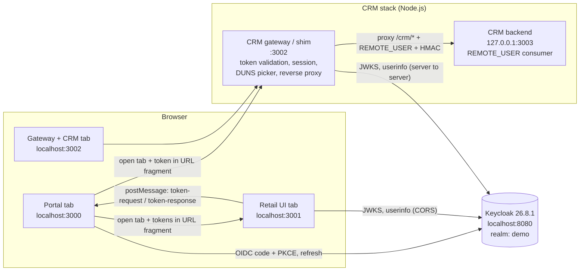

### 2.2 Components

| Component | Dir | Port | Tech | Responsibility |
|---|---|---|---|---|
| Keycloak | (Docker) | 8080 | Keycloak 26.8.1, `start-dev`, H2 | Identity provider: login, MFA, tokens, JWKS, userinfo |
| Portal | `portal/` | 3000 | React 19 + Vite dev server | OIDC client; DUNS drop-down; role tiles; token refresh; token hand-off |
| Retail UI | `retail-ui/` | 3001 | React 19 + Vite dev server | Validates tokens in the browser; per-DUNS product catalog |
| CRM gateway ("shim") | `crm-shim/` | 3002 | Node `http` server + React build | Server-side token validation; session; DUNS picker; reverse proxy that injects `REMOTE_USER` |
| CRM backend + UI | `crm-app/` | 3003 (127.0.0.1 only) | Node `http` server + React build | Serves the CRM UI and APIs; identifies the caller only from a signed `REMOTE_USER` |
| Retail API | `retail-api/` | 8090 (Docker container) | Spring Boot 3.5, Java 21 | REST endpoints for toys/flowers; verifies access + ID JWTs and the `RETAILUI` role (section 13) |

The portal, Retail UI and the gateway are separate **origins** (different ports), which is why hand-off uses the
URL fragment and `postMessage` rather than shared storage. The CRM UI and gateway share the origin
`localhost:3002` because the gateway reverse-proxies the CRM under `/crm/`.

### 2.3 Trust boundaries

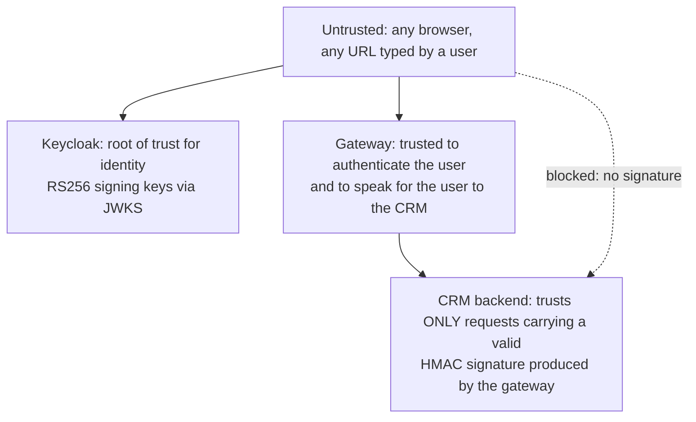

---

## 3. Identity model (Keycloak)

All of this is created by `scripts/setup-keycloak.sh` (idempotent).

### 3.1 Realm

`demo` (display name "Demo Realm"). Issuer: `http://localhost:8080/realms/demo`.
Token lifetimes are Keycloak defaults: access token 300 s, SSO session idle 1800 s, SSO session max 36000 s.

### 3.2 Clients

| Client ID | Type | Purpose |
|---|---|---|
| `demo-ui` | Public, standard flow only, PKCE `S256` required, direct-grant disabled. Redirect URI `http://localhost:3000/*`. Web origins `http://localhost:3000`, `http://localhost:3001`. Post-logout redirect `http://localhost:3000/*` | The portal's OIDC client. All tokens in the system are issued to it. |
| `retail-ui` | Bearer-only | Exists only to be an **audience**: lets Retail UI check that an access token was meant for it. |
| `crm-ui` | Bearer-only | Same, for the CRM gateway. |

Why bearer-only audience clients? The portal is the only interactive client. Child apps receive the portal's token,
so the way to bind a token to a consumer is the `aud` claim: an *Audience* mapper on `demo-ui` adds `retail-ui` and
`crm-ui` to the access token's `aud`.

### 3.3 Users, roles, attributes

| Item | Value |
|---|---|
| Test user | `testuser` / `password` |
| Realm role | `portal-admin` (assigned to the test user; surfaced as the `roles` claim) |
| User attribute `department` | `Engineering` |
| User attribute `employee_id` | `E-1001` |
| User attribute `duns_roles` (multivalued, max 512 chars) | `111111111:USA,RETAILUI,CRM` and `222222222:USA,RETAILUI,CRM,DAM_OP,CRR` |

The three attributes are declared in the realm's **user profile** (Keycloak 26 drops undeclared attributes).

### 3.4 Claims (protocol mappers on `demo-ui`)

| Mapper | Type | Claim | In ID token | In access token |
|---|---|---|---|---|
| `department` | User attribute | `department` (string) | yes | yes |
| `employee_id` | User attribute | `employee_id` (string) | yes | yes |
| `duns_roles` | User attribute, multivalued | `duns_roles` (string array) | yes | yes |
| `portal-roles` | Realm role | `roles` (string array) | yes | yes |
| `retail-ui-audience` | Audience | adds `retail-ui` to `aud` | no | yes |
| `crm-ui-audience` | Audience | adds `crm-ui` to `aud` | no | yes |

**`duns_roles` format.** Input format, one array element per DUNS:

```
DUNS : {ROLES}
111111111 : {USA,RETAILUI,CMM}      stored as   "111111111:USA,RETAILUI,CRM"
222222222 : {USA,DAM_OP,CRR}        stored as   "222222222:USA,RETAILUI,CRM,DAM_OP,CRR"
```

Parser (identical in portal, Retail UI and gateway): for every string drop `{` `}`, split on the first `:`, split the
right side on `,`, trim, drop empties, giving `{ "111111111": ["USA","RETAILUI","CRM"], ... }`.

A decoded access token (abridged):

```json
{
  "iss": "http://localhost:8080/realms/demo",
  "aud": ["crm-ui", "retail-ui", "account"],
  "azp": "demo-ui",
  "sub": "c8f81d16-...",
  "preferred_username": "testuser",
  "name": "Test User",
  "email": "testuser@example.com",
  "department": "Engineering",
  "employee_id": "E-1001",
  "roles": ["portal-admin", "default-roles-demo", "offline_access", "uma_authorization"],
  "duns_roles": ["111111111:USA,RETAILUI,CRM", "222222222:USA,RETAILUI,CRM,DAM_OP,CRR"],
  "exp": 1793900000
}
```

### 3.5 MFA

The built-in `browser` flow contains a conditional OTP sub-flow that prompts any user who has an OTP credential.
`CONFIGURE_TOTP` is enabled **and** a default required action, so a new user must enrol an authenticator app
(QR code) at their first login. Login order afterwards: username, password, 6-digit TOTP code.

---

## 4. Flow A: Portal login

OIDC **Authorization Code flow with PKCE (S256)**, implemented without a library in `portal/src/auth.js`.

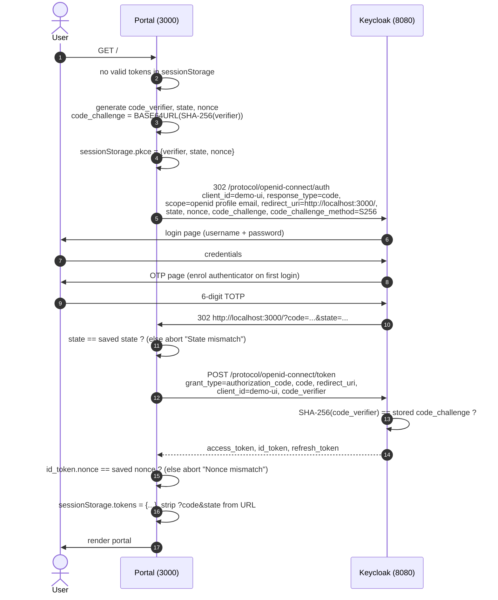

Properties:

- **PKCE** prevents authorization-code interception: the code is useless without the one-time `code_verifier` that never
  left the browser.
- **state** binds the response to the request (CSRF). **nonce** binds the ID token to the request (replay).
- Tokens are held in `sessionStorage` (per tab, cleared on tab close). There is no client secret (public client).
- The portal does **not** verify the portal's own tokens' signature: they come straight from Keycloak's token endpoint
  over a direct channel, which is the OIDC-sanctioned trust model for the code flow.
- Logout: `GET /protocol/openid-connect/logout?id_token_hint=...&post_logout_redirect_uri=http://localhost:3000/`.

---

## 5. Flow B: Token refresh

Access tokens live 5 minutes. The portal keeps the user signed in without a redirect.

### 5.1 Portal

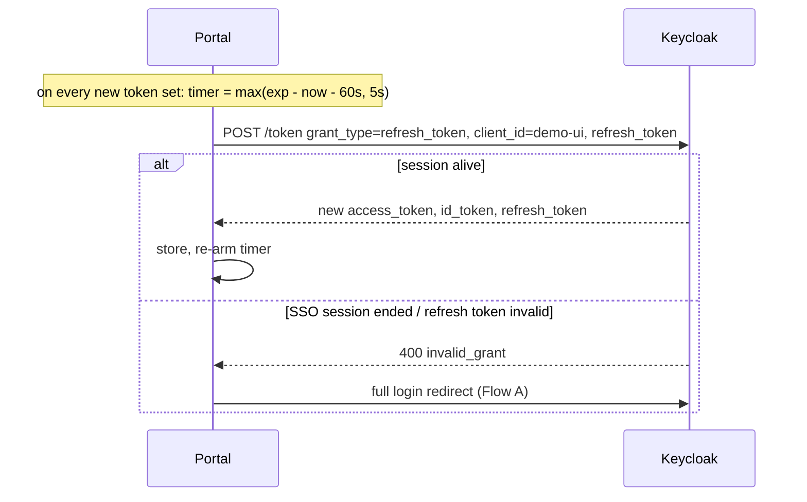

- Concurrent refreshes are de-duplicated (single in-flight promise).
- If the tab was asleep, a `visibilitychange` handler refreshes immediately when less than 60 s remain.
- On page load with an expired access token the stored refresh token is tried before falling back to login.
- Keycloak SSO idle timeout is 30 min and max is 10 h; refreshing every ~4 min keeps an open tab alive until the 10 h cap.

### 5.2 Retail UI (token lease over `postMessage`)

Retail UI never receives the refresh token. The portal tab that opened it holds the refresh token and answers requests.

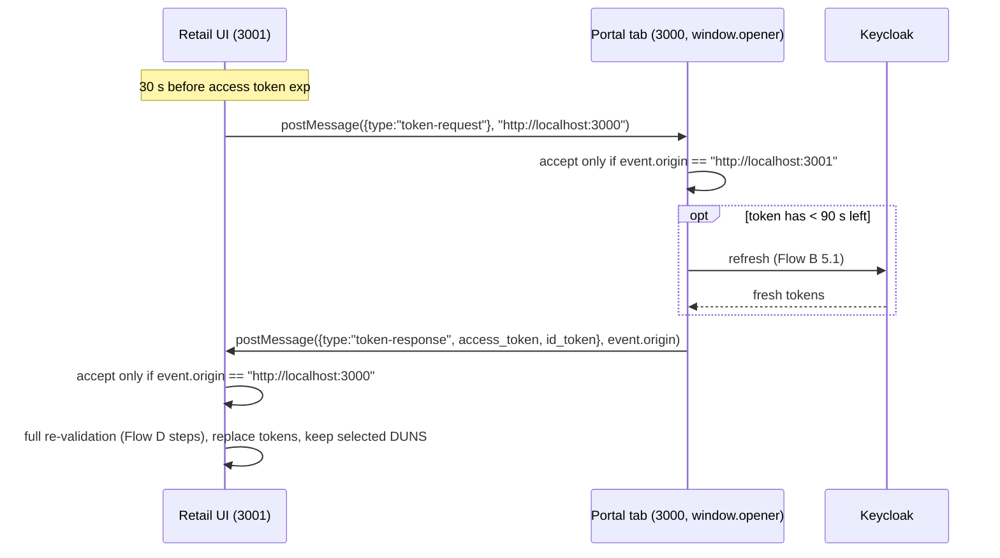

If the portal tab is closed, or does not answer, Retail UI ends its session at token expiry (+2 s) with
"Session expired, relaunch from the portal". The portal opens Retail UI without `noopener` precisely so that
`window.opener` exists.

The CRM gateway does not use this channel; it has its own server-side session (section 8).

---

## 6. Flow C: DUNS selection and tiles

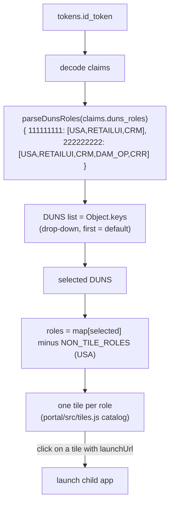

- Changing the drop-down re-renders the tiles with no reload.
- `USA` is in `NON_TILE_ROLES`: it grants access but renders no tile. Roles unknown to the catalog still render a
  generic tile.
- Tiles with a `launchUrl` (`RETAILUI` -> `http://localhost:3001/`, `CRM` -> `http://localhost:3002/`) open a **new tab**.
- Hand-off for Retail UI: `http://localhost:3001/#access_token=...&id_token=...&duns=<selected>`.
  Hand-off for CRM: `http://localhost:3002/#access_token=...&id_token=...&duns=<selected>` (the gateway ignores
  `id_token` and `duns`; it shows all DUNS).
- A URL **fragment** is used because browsers never send it to any server, so tokens are not written to server logs or
  `Referer` headers. Receivers erase it from the address bar immediately (`history.replaceState`).

---

## 7. Flow D: Launching Retail UI

Retail UI validates the tokens **in the browser** (`retail-ui/src/validate.js`) using the Web Crypto API.

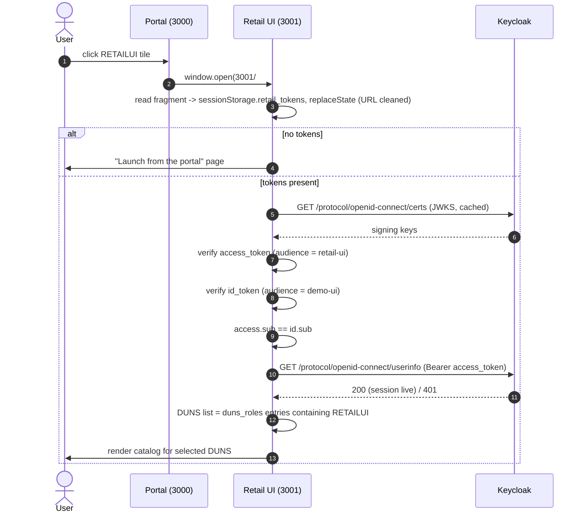

### 7.1 Validation checklist (applied to both tokens)

| # | Check | Failure message |
|---|---|---|
| 1 | Three dot-separated parts | `Malformed token` |
| 2 | Header `alg == RS256` (rejects `none`/HS256 downgrades) | `Unexpected algorithm` |
| 3 | `kid` found in Keycloak JWKS with `use == sig` | `Token signed by an unknown key` |
| 4 | RSASSA-PKCS1-v1_5 / SHA-256 signature verifies over `header.payload` | `Invalid token signature` |
| 5 | `iss == http://localhost:8080/realms/demo` | `Unexpected token issuer` |
| 6 | `exp` in the future | `Token has expired` |
| 7 | `aud` contains `retail-ui` (access token) / `demo-ui` (ID token) | `Token not issued for ...` |
| 8 | `access.sub == id.sub` | `Token subject mismatch` |
| 9 | `userinfo` returns 200 for the access token (user session still active, not logged out) | `Keycloak session is no longer active` |

Any failure shows an "Access denied" page with the reason and a link back to the portal; stored tokens are discarded.

### 7.2 Authorization inside Retail UI

- Authorization data comes from the **validated access token's** `duns_roles`.
- The DUNS drop-down lists every DUNS in the token; those lacking `RETAILUI` are disabled and labelled "(no access)".
  If the user has no DUNS with `RETAILUI`, a "No access" page is shown.
- The default DUNS is the one the portal had selected (the `duns` hint), else the first allowed. The user may change it
  at any time; the catalog (`retail-ui/src/catalog.js`) switches between Toy Shop and Flower Shop.

### 7.3 Limits of browser-side validation

Anyone can edit browser JavaScript, so this proves integration rather than enforcing security. A real deployment
validates tokens in a backend (compare the CRM gateway, Flow E) and serves data from it.

---

## 8. Flow E: Launching CRM

The CRM is modelled on a legacy application that trusts a web-server-injected `REMOTE_USER` (as with Apache/SiteMinder
style SSO). The **gateway** converts an OIDC token into that header.

### 8.1 End-to-end sequence

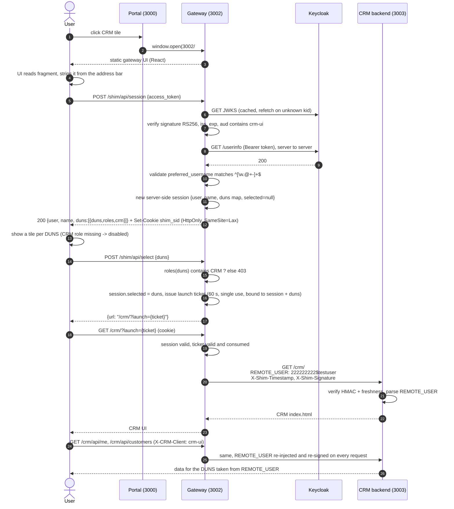

### 8.2 Server-side token validation (gateway)

Implemented in `crm-shim/server.js` (`validateAccessToken`) with Node's `crypto` only (no JWT library).

| # | Step |
|---|---|
| 1 | Split into 3 parts; reject if malformed |
| 2 | `alg` must be `RS256` |
| 3 | Find JWKS key by `kid` (`use == sig`); on a miss re-fetch the JWKS once (handles key rotation) |
| 4 | `crypto.verify('RSA-SHA256', "<h>.<p>", publicKeyFromJwk, signature)` |
| 5 | `iss == http://localhost:8080/realms/demo` |
| 6 | `exp` not passed |
| 7 | `aud` contains `crm-ui` |
| 8 | `GET /userinfo` with the bearer token must be 200 (revoked/ended sessions are rejected) |
| 9 | `preferred_username` must match `^[\w.@+-]+$` (prevents header injection; the name goes into an HTTP header) |

Validation happens **once per launch** (on `POST /shim/api/session`); afterwards the server-side session stands in for the
token.

### 8.3 Gateway session

| Property | Value |
|---|---|
| Storage | In-memory `Map` (lost on restart) |
| Cookie | `shim_sid`, 24 random bytes base64url, `HttpOnly`, `SameSite=Lax`, `Path=/` (add `Secure` behind TLS) |
| Content | `user`, `name`, parsed `duns -> roles`, `selected` DUNS, timestamps |
| Idle timeout | 30 min (sliding) |
| Absolute timeout | 8 h |
| Created by | Only `POST /shim/api/session` with a valid token (replaces any previous session) |
| CSRF | State-changing calls reject a mismatching `Origin` header; cookie is `SameSite=Lax` |

### 8.4 The DUNS picker ("shim layer")

- The picker UI never reads the DUNS list from a cookie. The list is returned **in the response to a token (or ticket)
  submission** and kept only in React memory. Reloading the picker without a fragment therefore shows
  "Launch from the portal".
- Tiles are drawn for every DUNS in the token; a DUNS whose roles lack `CRM` is disabled, and the server enforces it too
  (`403 No CRM access for this DUNS`).

### 8.5 Launch ticket (entering the CRM)

Opening `/crm` pages requires `?launch=<ticket>`:

| Property | Value |
|---|---|
| Created | by `POST /shim/api/select` |
| Lifetime | 60 s |
| Use | exactly once (deleted on first look-up) |
| Bound to | the session id **and** the selected DUNS |

Request classification inside `/crm/*`:

| Path | Requirement |
|---|---|
| `/crm/api/*` | live session with a selected DUNS **and** header `X-CRM-Client: crm-ui` (so typing an API URL in the address bar fails) |
| `/crm/assets/*` | live session with a selected DUNS (static JS/CSS) |
| everything else (page loads: `/crm`, `/crm/`, `/crm/anything`) | live session **and** a valid single-use launch ticket. Otherwise 401 "Launch from the portal" page |

Consequence: reloading the CRM page, or bookmarking it, shows the launch page. Navigation *inside* the CRM (left nav) is
client-side and unaffected.

### 8.6 Switching DUNS from inside the CRM

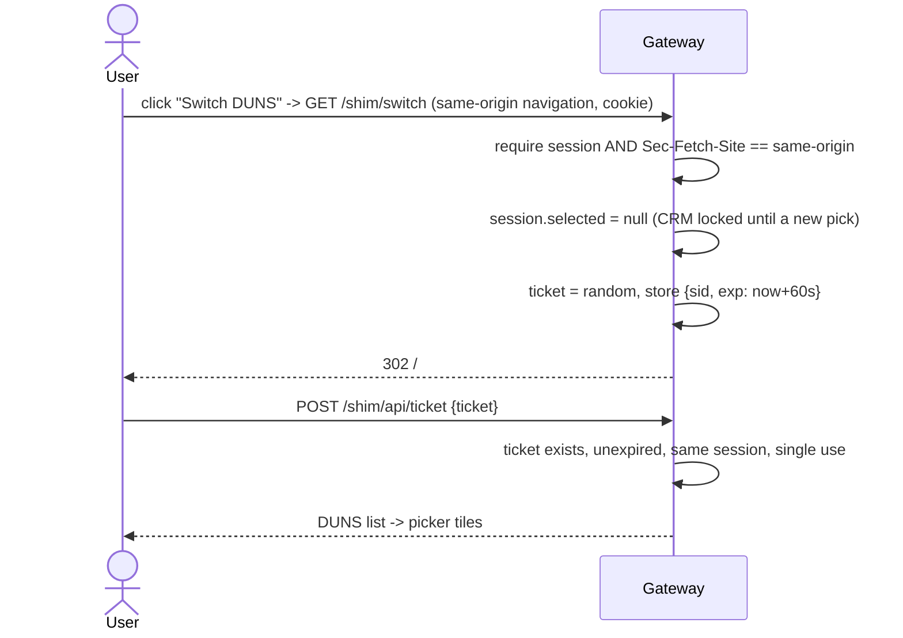

Typing `/shim/switch` in the address bar sends `Sec-Fetch-Site: none` and gets 403. Opening `/` without a fragment shows
the launch page.

---

## 9. `REMOTE_USER` in depth

### 9.1 Purpose

The CRM does not understand OIDC. It identifies the caller from one HTTP request header:

```
REMOTE_USER: <duns>$<username>        e.g.   REMOTE_USER: 222222222$testuser
```

- `<duns>`: the DUNS the user picked on the gateway (9 digits).
- `$`: delimiter. The CRM splits on the **first** `$`.
- `<username>`: Keycloak `preferred_username` (restricted to `[\w.@+-]+`, so it cannot contain `$` or control characters).

The header carries *identity plus tenant* in one value, so every CRM request is automatically scoped to one company.

### 9.2 Who sets it, who may not

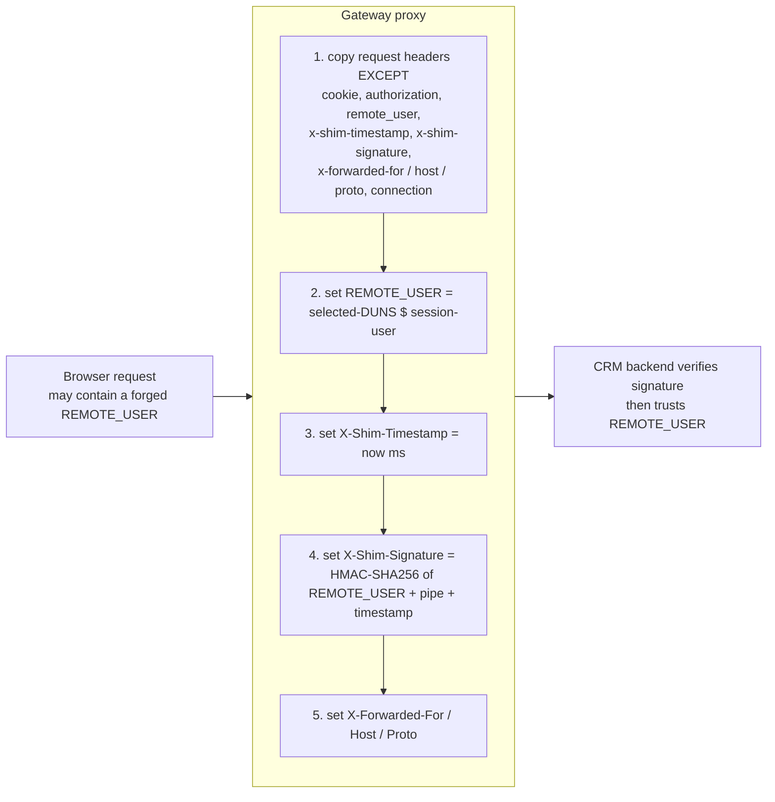

The browser-supplied value is **always discarded**; the value that reaches the CRM comes from the server-side session,
which came from a validated token.

### 9.3 Signature (why a header alone is not trusted)

Anything that can reach port 3003 could otherwise just type a `REMOTE_USER`. The backend therefore also requires:

```
X-Shim-Timestamp: <unix epoch milliseconds>
X-Shim-Signature: hex( HMAC-SHA256( SHIM_SECRET, REMOTE_USER + "|" + X-Shim-Timestamp ) )
```

Backend verification (`crm-app/server.js`, `trusted()`):

1. All three headers present.
2. `|now - timestamp| <= 30 s` (limits replay of a captured request).
3. Recompute the HMAC with the shared key; compare with `crypto.timingSafeEqual` (constant time).

If any check fails the response is **403**: an HTML "Launch from the portal" page for browsers, JSON otherwise.
The backend also binds to `127.0.0.1`, so it is unreachable from the network.

`SHIM_SECRET` is generated per start by `scripts/start.sh` (`openssl rand -hex 32`) and passed to both processes through the
environment. Both fall back to a fixed development constant only if the variable is unset.

### 9.4 Parsing and use in the CRM

After the signature passes, the backend:

1. Splits `REMOTE_USER` at the first `$` into `duns` and `user`; rejects (403) if there is no `$`, `duns` is not exactly 9
   digits, or `user` is empty.
2. Uses `duns` to select the data set: `/crm/api/customers` returns the Toy Shop or Flower Shop customers.
3. Exposes both through `GET /crm/api/me`, shown in the CRM top bar (`DUNS 222222222`, username).

No token, cookie, or other credential reaches the CRM backend.

### 9.5 Header naming caveat

`REMOTE_USER` contains an underscore. Node.js preserves it. Many HTTP servers and proxies (nginx by default, Apache
mod_proxy variants) **drop headers with underscores** unless configured (`underscores_in_headers on` in nginx). If this
design is ported behind such a proxy, either enable underscore headers or agree an alternative name (e.g. `Remote-User`).

### 9.6 Snoop page

CRM left nav -> **Snoop** calls `GET /crm/api/snoop`, which returns the request line and `req.rawHeaders`, i.e. the headers
exactly as received (original case and order), including `REMOTE_USER` (highlighted), `X-Shim-Timestamp`,
`X-Shim-Signature`, `X-Forwarded-*`, `Host`, `User-Agent`, `Accept`, and `X-CRM-Client`. Browser cookies are not present
because the gateway strips them. The HMAC key is never shown (only the derived signature, which is only valid for
30 seconds for that exact value).

Example (abridged):

```
GET /crm/api/snoop  HTTP/1.1
Host:               localhost:3002
REMOTE_USER:        222222222$testuser
X-Shim-Timestamp:   1793900123456
X-Shim-Signature:   9f2c...e1
X-Forwarded-For:    ::1
X-Forwarded-Host:   localhost:3002
X-Forwarded-Proto:  http
X-CRM-Client:       crm-ui
```

---

## 10. Direct-access and bookmark behaviour

| Scenario | Result | Enforced by |
|---|---|---|
| Open Retail UI `:3001` directly | "Launch from the portal" page | Retail UI (no tokens) |
| Open Retail UI with a tampered/expired/other-audience token | "Access denied" + reason | Retail UI validation |
| Open gateway `:3002/` directly or after reload | "Launch from the portal" page | Gateway UI (no fragment) |
| Open gateway with a bogus token | "Access denied: ..." | `POST /shim/api/session` -> 401 |
| `GET /shim/api/session` (old list endpoint) | 404 | removed |
| Type `/shim/switch` in the address bar | 403 launch page | `Sec-Fetch-Site` check |
| Type/bookmark `/crm`, `/crm/`, `/crm/x` with a live session | 401 launch page | missing/used launch ticket |
| Type `/crm/api/me` in the address bar | 403 | missing `X-CRM-Client` |
| Reuse or forge `?launch=` | 401 | single-use, session-bound |
| `/crm/*` with no session | 401 | session check |
| Call CRM backend `:3003` directly with no headers | 403 | HMAC check |
| Call `:3003` with forged `REMOTE_USER` (any signature) | 403 | HMAC check |
| Replay a captured signed request after 30 s | 403 | timestamp window |
| Browser sends its own `REMOTE_USER` through the gateway | ignored and replaced | proxy header stripping |
| Pick a DUNS without the `CRM` role | 403 | `POST /shim/api/select` |

`scripts/smoke-test.sh` automates the non-login rows.

---

## 11. Reference tables

### 11.1 Gateway endpoints (`crm-shim/server.js`, port 3002)

| Method + path | Auth | Purpose |
|---|---|---|
| `POST /shim/api/session` | body `access_token` (validated) | Create session, return `{user, name, duns[]}`, set `shim_sid` |
| `DELETE /shim/api/session` | cookie | Destroy session |
| `POST /shim/api/select` | cookie | Choose DUNS; returns `/crm/?launch=<ticket>` |
| `POST /shim/api/ticket` | cookie + one-time ticket | Redeem a "Switch DUNS" ticket for the DUNS list |
| `GET /shim/switch` | cookie + `Sec-Fetch-Site: same-origin` | Clear selection, 302 to `/#ticket=...` |
| `/crm/*` | cookie (+ ticket / `X-CRM-Client` per section 8.5) | Reverse proxy to the CRM backend with `REMOTE_USER` |
| anything else | none | Static gateway UI (`crm-shim/dist`, SPA fallback) |

### 11.2 CRM backend endpoints (`crm-app/server.js`, 127.0.0.1:3003)

All require a valid HMAC-signed `REMOTE_USER`.

| Path | Returns |
|---|---|
| `/crm/api/me` | `{remoteUser, duns, user, company}` |
| `/crm/api/customers` | customers of the DUNS in `REMOTE_USER` |
| `/crm/api/snoop` | request line + raw headers |
| `/crm/**` | CRM React build (SPA fallback) |

### 11.3 Where the constants live

| Setting | Value | File |
|---|---|---|
| Issuer, client id, redirect URI | `http://localhost:8080/realms/demo`, `demo-ui` | `portal/src/auth.js` |
| Retail issuer / audiences / portal URL | | `retail-ui/src/validate.js` |
| Gateway issuer / audience `crm-ui`, ports, session timeouts | | `crm-shim/server.js` |
| Role to tile catalog, launch URLs, non-tile roles | | `portal/src/tiles.js` |
| Product catalogs | | `retail-ui/src/catalog.js` |
| CRM customer data | | `crm-app/server.js` |
| DUNS role data, realm, clients, mappers | | `scripts/setup-keycloak.sh` |
| Retail API issuer, JWKS URI, audiences, required role, catalog DUNS | | `retail-api/src/main/resources/application.yml`, `retail-api/docker-compose.yml` |

### 11.4 Timers at a glance

| What | Value |
|---|---|
| Access token | 5 min |
| Portal proactive refresh | 60 s before expiry (min 5 s) |
| Retail UI token request | 30 s before expiry; hard stop at expiry + 2 s |
| Keycloak SSO idle / max | 30 min / 10 h |
| Gateway session idle / max | 30 min / 8 h |
| Launch / switch ticket | 60 s, single use |
| `REMOTE_USER` signature freshness | 30 s |

---

## 12. Security analysis

### 12.1 Threats considered

| Threat | Mitigation |
|---|---|
| Authorization-code interception | PKCE S256 |
| CSRF on the login redirect / ID-token replay | `state`, `nonce` |
| Token leakage to servers/logs/Referer | Tokens travel in URL fragments, removed from the address bar immediately; never in query strings |
| Forged or tampered token | RS256 signature check against Keycloak JWKS; `alg` pinned |
| Token meant for another service | Audience check (`retail-ui`, `crm-ui`) |
| Token of a logged-out user | `userinfo` call at launch |
| Forged `REMOTE_USER` from a browser | Gateway strips it; CRM trusts only HMAC-signed values |
| Direct calls to the CRM backend | Bound to 127.0.0.1; HMAC required; 30 s replay window |
| Session theft from JS | `shim_sid` is `HttpOnly`; CRM backend never sees it |
| Header injection via username | Username whitelist `[\w.@+-]+` |
| Open redirect / URL guessing of CRM | Single-use, session-bound launch tickets |
| Refresh-token exposure to child apps | Only the portal holds it; Retail UI uses `postMessage` with strict origin checks |

### 12.2 Known limitations (intentional, for a demo)

1. Plain HTTP everywhere; Keycloak in `start-dev` with the embedded H2 database and default `admin/admin`.
2. Tokens in `sessionStorage` are readable by any script on the same origin (XSS impact).
3. Retail UI validates in the browser (can be bypassed by editing JS); data is hard-coded.
4. Gateway sessions are in memory, single instance, and are not re-checked against Keycloak after launch (ending the
   Keycloak session does not end an existing gateway session until it times out).
5. Refresh tokens are not rotated (Keycloak default).
6. The Retail UI refresh channel needs the portal tab to stay open.
7. The same `demo-ui` token is used by all consumers; separation is by audience only, not by per-app clients.
8. Hard-coded origins (`localhost:3000-3003`, `8080`) in source; changing hosts requires code and Keycloak edits.
9. Automated tests exist only for the Retail API (37 Maven tests, Postman collection) and `scripts/smoke-test.sh`; the UIs and the gateway have none.
10. Retail API: no per-request revocation check, plain HTTP, in-memory data; the dev test client enables the password grant (section 13.10).

### 12.3 What to change for production

- TLS everywhere; `Secure` cookies; `https` issuer; real hostnames; Keycloak in production mode with PostgreSQL, a
  proper admin, and tightened redirect URIs/web origins.
- Validate tokens in a backend or API gateway for every app (use a maintained JWT library, cache JWKS with rotation).
- Move secrets (`SHIM_SECRET`) to a secret store; rotate; consider mutual TLS between gateway and CRM instead of or in
  addition to the HMAC.
- Shared session store (Redis) for the gateway; periodic back-channel logout or introspection to end sessions with the
  Keycloak session.
- Refresh-token rotation and reuse detection; consider the BFF pattern so browsers never hold tokens.
- Replace hard-coded data with real services; add rate limiting, audit logging, security headers (CSP,
  `X-Content-Type-Options`, `frame-ancestors`), and automated tests.

---

## 13. Retail REST API and external agents

`retail-api/` is a Spring Boot service that exposes the toy and flower catalogs over REST for **callers that are not
the portal**: scripts, back-office tools, other services, AI agents. It is protected by the same Keycloak realm and the
same custom claims as the UIs. This section documents the API, what it validates, and, step by step, what an external
agent must set up and do to obtain an **access token and an ID token** and call it.

### 13.1 Endpoints

| Method + path | Authorization (role `RETAILUI` under DUNS ...) | Result |
|---|---|---|
| `GET /api/toys`, `GET /api/toys/{id}` | `111111111` (Toy Shop) | catalog / one toy (`t1`..`t6`) |
| `GET /api/flowers`, `GET /api/flowers/{id}` | `222222222` (Flower Shop) | catalog / one flower (`f1`..`f6`) |
| `GET /api/me` | any DUNS | the identity and custom claims the API derived from the verified tokens |
| `GET /actuator/health` | none | liveness (public) |

Every `/api/**` call needs **two** tokens:

```
Authorization: Bearer <access token>
X-ID-Token:    <ID token>
```

Runs as container `retail-api` (image `retail-api:1.0.0`) on host port **8090**.

### 13.2 Architecture

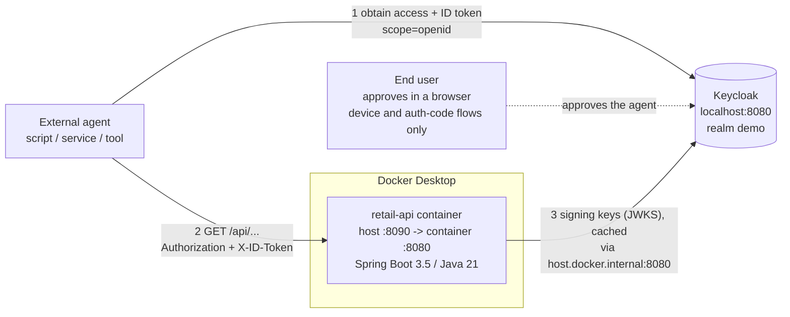

The agent talks to Keycloak and to the API; the API talks to Keycloak only to fetch (and cache) the public signing keys.
It is stateless: no session, no per-request call to Keycloak.

### 13.3 What the API validates

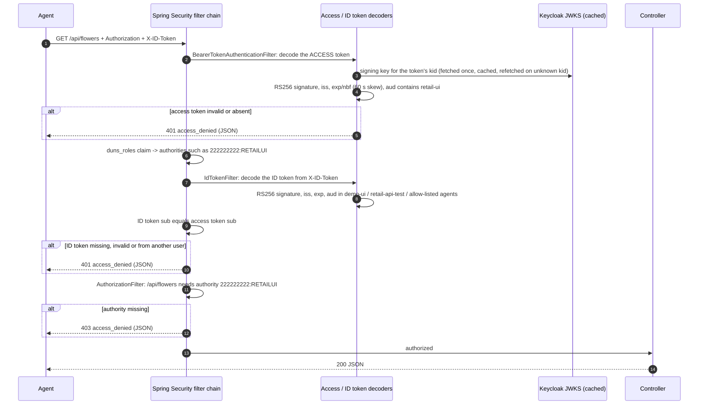

**Checks, in order**

| # | Check | On failure |
|---|---|---|
| 1 | `Authorization: Bearer ...` present, parseable JWT, `alg` = RS256 (so `none` and HS256 are rejected) | 401 |
| 2 | Access token signature valid against a key in Keycloak's JWKS | 401 |
| 3 | Access token `iss` = `http://localhost:8080/realms/demo`, not expired | 401 |
| 4 | Access token `aud` contains `retail-ui` (the audience mapper puts it there) | 401 |
| 5 | `X-ID-Token` present | 401 |
| 6 | ID token signature, `iss`, expiry valid | 401 |
| 7 | ID token `aud` is one of `RETAIL_SECURITY_ID_AUDIENCES` (default `demo-ui, retail-api-test`) | 401 |
| 8 | ID token `sub` = access token `sub` | 401 |
| 9 | Access token `duns_roles` grants `RETAILUI` for the DUNS that owns the endpoint (toys 111111111, flowers 222222222; `/api/me` any DUNS) | 403 |
| 10 | Token verification cannot run because Keycloak's signing keys are unreachable | **503** `service_unavailable` + `Retry-After: 5` (not the caller's fault; the API starts without Keycloak and recovers on its own) |

Authentication and authorization failures use one body, so callers handle a single shape:

```json
{ "timestamp": "2026-11-07T20:04:51Z", "status": 401, "error": "access_denied",
  "message": "Access denied: ...", "path": "/api/toys" }
```

401 responses also carry `WWW-Authenticate: Bearer realm="retail-api"`. Unknown paths are never 404 for unauthenticated or
unauthorized callers (401/403), so the API does not reveal which routes exist.

Why both tokens? The access token carries what the caller may do (`duns_roles`, audience) and the ID token proves who
authenticated and to which client. Requiring both, bound by `sub`, stops a caller from combining a token that grants rights with
an unrelated identity token.

### 13.4 One-time setup for an external agent

Three parties are involved: the **Keycloak administrator**, the **API operator**, and the **end user** the agent acts for.
(In this repo one person plays all three.)

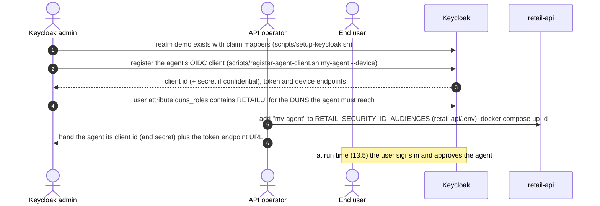

| # | Who | Action | Command / where | What breaks if skipped |
|---|---|---|---|---|
| 1 | Admin | Keycloak running with the `demo` realm, claim mappers, `duns_roles` attribute | `./scripts/start-keycloak.sh && ./scripts/setup-keycloak.sh` | no tokens at all |
| 2 | Admin | Register the agent as an OIDC client. Choose the grant it will use (see 13.5). The script adds the same mappers as the portal (`duns_roles`, `roles`, `department`, `employee_id`) and the **`retail-ui` audience on the access token** | `cd retail-api && ./scripts/register-agent-client.sh my-agent --device` (add `--confidential` for a client secret, `--password-grant` for dev/test) | access token lacks `duns_roles` / `aud retail-ui` -> 401 or 403 |
| 3 | Admin | Make sure the user the agent acts for has `RETAILUI` for the DUNS they need, in the `duns_roles` attribute, e.g. `111111111:USA,RETAILUI` | Admin console -> Users -> *user* -> Attributes -> **DUNS roles** | 403 `role RETAILUI is required for DUNS ...` |
| 4 | Operator | **Allow-list the client's ID-token audience** in the API. The ID token's `aud` is the client id, and the API accepts only listed clients | create `retail-api/.env` containing `RETAIL_SECURITY_ID_AUDIENCES=demo-ui,retail-api-test,my-agent`, then `docker compose up -d` (keep existing entries; use `.env`, because an inline variable is lost on the next `up`) | 401 `Token audience [my-agent] is not accepted by this API` |
| 5 | Operator | Give the agent: client id, client secret (if confidential), token endpoint `http://localhost:8080/realms/demo/protocol/openid-connect/token`, API base `http://localhost:8090` | out of band | |

Facts about the registered client (what `register-agent-client.sh` sets):

- Standard (browser redirect) flow **off**, service accounts **off**. A client-credentials token has no user and no ID token,
  so it can never satisfy this API.
- Public client by default; `--confidential` adds a secret that the agent must send as `client_secret`.
- The `retail-ui` audience mapper is on the **access** token only; the ID token's audience is the client itself.

### 13.5 Run time: how the agent gets its two tokens

Both tokens come from the same Keycloak token response when the request includes **`scope=openid`** (without it Keycloak returns
no `id_token`). Pick one grant; all three yield `access_token`, `id_token` and `refresh_token`.

| Grant | Use for | User interaction | MFA | Verified here |
|---|---|---|---|---|
| **A. Device authorization** (recommended for headless agents acting for a person) | CLIs, daemons, AI agents, anything without a browser | user opens a URL on any device, signs in, approves | works (the portal's TOTP applies) | yes, end to end |
| **B. Authorization code + PKCE** | agents that can open a browser and receive a redirect (same flow as the portal, section 4) | browser sign-in | works | same flow as the portal; needs "Standard flow" and redirect URIs enabled on the client |
| **C. Password (direct) grant** | local development, CI, Postman, `examples/call-api.sh` | none (agent holds the password) | **cannot** (users must be MFA-less) | yes |

#### A. Device authorization grant (headless agent, user approves)

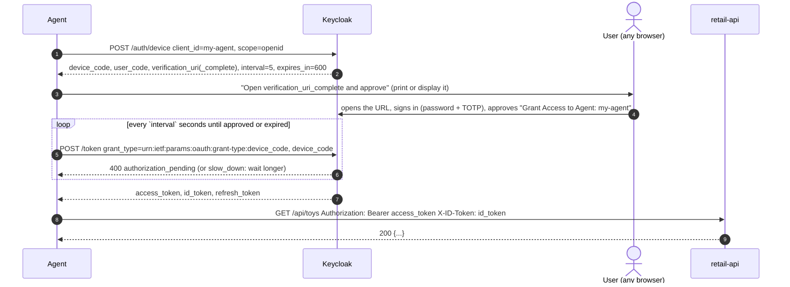

```bash
KC=http://localhost:8080/realms/demo/protocol/openid-connect

# 1. ask for a device code
curl -s -d client_id=my-agent -d scope=openid $KC/auth/device
#  -> {"device_code":"...","user_code":"ABCD-EFGH",
#      "verification_uri_complete":"http://localhost:8080/realms/demo/device?user_code=ABCD-EFGH",
#      "expires_in":600,"interval":5}

# 2. the user opens verification_uri_complete in a browser, signs in, clicks Yes

# 3. poll (no faster than `interval`) until it returns tokens
curl -s -d client_id=my-agent -d grant_type=urn:ietf:params:oauth:grant-type:device_code \
     -d device_code=<device_code> $KC/token
#  -> {"error":"authorization_pending"} ... then {"access_token":"...","id_token":"...","refresh_token":"..."}
```

For a confidential client add `-d client_secret=<secret>` to the polling and refresh requests.

#### B. Authorization code + PKCE

Identical to section 4 with the agent's `client_id`: send the user to `/protocol/openid-connect/auth` with `response_type=code`,
`scope=openid`, `code_challenge` (S256), `state`, `nonce` and a registered `redirect_uri`; exchange the returned code at `/token`
with the `code_verifier`. The client needs *Standard flow* and the redirect URI enabled in the admin console (the registration
script leaves them off). The ID token's `aud` is again the agent's client id, so step 4 of 13.4 still applies.

#### C. Password grant (dev/test only)

```bash
curl -s -d client_id=my-agent -d grant_type=password -d username=apiuser -d password=password \
     -d scope=openid http://localhost:8080/realms/demo/protocol/openid-connect/token
#  -> {"access_token":"...","id_token":"...","refresh_token":"...","expires_in":300}
```

`retail-api/examples/call-api.sh` runs this and then calls the API (and a refresh). The dev client `retail-api-test` and the
users `apiuser`, `toyonly`, `noretail` come from `retail-api/scripts/setup-keycloak-api-test.sh`.

### 13.6 Calling the API

```bash
ACCESS=<access_token>   ID=<id_token>

curl -H "Authorization: Bearer $ACCESS" -H "X-ID-Token: $ID" http://localhost:8090/api/toys
curl -H "Authorization: Bearer $ACCESS" -H "X-ID-Token: $ID" http://localhost:8090/api/flowers/f1
curl -H "Authorization: Bearer $ACCESS" -H "X-ID-Token: $ID" http://localhost:8090/api/me
```

Success (`200`):

```json
{ "duns": "111111111", "company": "Toy Shop", "count": 6,
  "items": [ { "id": "t1", "name": "Teddy Bear", "category": "Plush", "price": 19.99, "stock": 42 }, ... ] }
```

### 13.7 Token lifetime and refresh

| Token | Lifetime | Renewal |
|---|---|---|
| access token and ID token | 300 s | request new ones with the refresh token |
| refresh token | until the Keycloak SSO session ends (30 min idle, 10 h max) | each refresh extends the idle window |

```bash
curl -s -d client_id=my-agent -d grant_type=refresh_token -d refresh_token=<refresh_token> -d scope=openid \
     http://localhost:8080/realms/demo/protocol/openid-connect/token
#  -> new access_token AND id_token (replace both; the API needs a matching pair)
```

Recommended agent loop: before each API call, if the access token expires in under ~30 s, refresh. If refresh returns
`invalid_grant` (session ended), run the original grant again (for device flow that means asking the user to approve again).
The `exp` claim is in the token payload (second dot-separated segment, base64url JSON).

### 13.8 End-to-end runtime sequence (device grant)

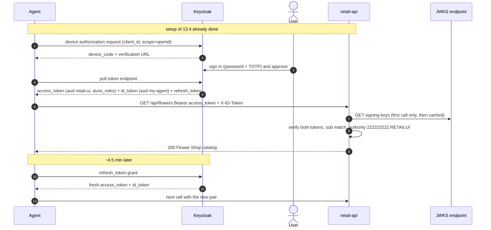

### 13.9 Troubleshooting for agents

| Response / message | Cause | Fix |
|---|---|---|
| 401 `a valid access token is required` | no `Authorization: Bearer` header | send it |
| 401 `...Jwt expired at ...` | access or ID token older than 5 min | refresh (13.7) |
| 401 `...Signed JWT rejected: Invalid signature` | token altered or from another realm/Keycloak | use a token straight from this Keycloak |
| 401 `...Token audience [...] is not accepted by this API` on the **access** token | client lacks the `retail-ui` audience mapper | register the client with `register-agent-client.sh` (13.4 step 2) |
| 401 `invalid ID token: ... Token audience [my-agent] is not accepted` | client not allow-listed in the API | 13.4 step 4 (`.env` + `docker compose up -d`) |
| 401 `ID token missing (send it in the X-ID-Token header)` | second token not sent | add the header |
| 401 `ID token does not belong to the same user as the access token` | tokens from two different users/sessions | use the pair from one token response |
| 503 `Token verification is temporarily unavailable` (with `Retry-After`) | API cannot fetch signing keys from Keycloak (down, or container cannot reach `host.docker.internal:8080`) | wait and retry; check Keycloak; the API recovers by itself |
| 403 `role RETAILUI is required for DUNS 222222222` | user's `duns_roles` lacks `RETAILUI` for that DUNS | admin edits the user attribute (13.4 step 3), then the agent gets **new** tokens (claims are copied into tokens at issue time) |
| token response has no `id_token` (then 401 `ID token missing`) | `scope=openid` missing from the token request | add `scope=openid` |
| `unauthorized_client` at the token endpoint | confidential client without `client_secret`, or grant not enabled on the client | send the secret / re-run the registration script with the right flag |
| `slow_down` while polling the device grant | polling faster than `interval` | wait `interval` seconds (it grows after `slow_down`) |

### 13.9a Variant: one scope per DUNS, role selected by the `resource` parameter

Besides one scope per (DUNS, role) (`<DUNS>:<ROLE>`), the realm can offer **one scope per DUNS** (`duns-<DUNS>`) that maps all
roles of that DUNS. The caller still identifies the DUNS by its client (`retail-duns-<DUNS>`), and names the wanted role in the
token request: `scope=openid duns-111111111 resource=RETAILUI`. A custom protocol mapper
(`keycloak-extensions/resource-role-mapper`, a Java SPI jar in Keycloak's `providers/` directory) runs after the standard role
mapper and removes every role not listed in `resource`, so the token carries exactly the requested role. It never adds roles
(a role the user lacks stays absent), no `resource` yields no roles, and refresh tokens keep the originally requested role.
The API is unchanged. Keycloak's script mappers were not used: they are deprecated, disabled by default and need a deployed jar
anyway. Setup and test matrix: `retail-api/README.md` ("Variant: one scope per DUNS") and Postman folders 7-9.

### 13.10 Security notes for agents

- Prefer the **device** or **authorization-code + PKCE** grant. The password grant exists here for development, because it needs the
  agent to hold the user's password and cannot work with MFA.
- A confidential client's secret must live in a secret store, never in the repository or the prompt of an AI agent.
- Tokens are bearer credentials: send them only over HTTPS in a real deployment (this demo is plain HTTP on localhost).
- The API does **not** ask Keycloak whether a token has been revoked or the user logged out; a stolen token works until it
  expires (<= 5 min). The window is the access token lifetime.
- The allow-list of ID-token audiences (`RETAIL_SECURITY_ID_AUDIENCES`) is the gate that decides *which clients* may call the API;
  add a client only after reviewing it.
- Authorization data comes from user attributes at token-issue time; role changes take effect when the agent next obtains
  or refreshes tokens.
